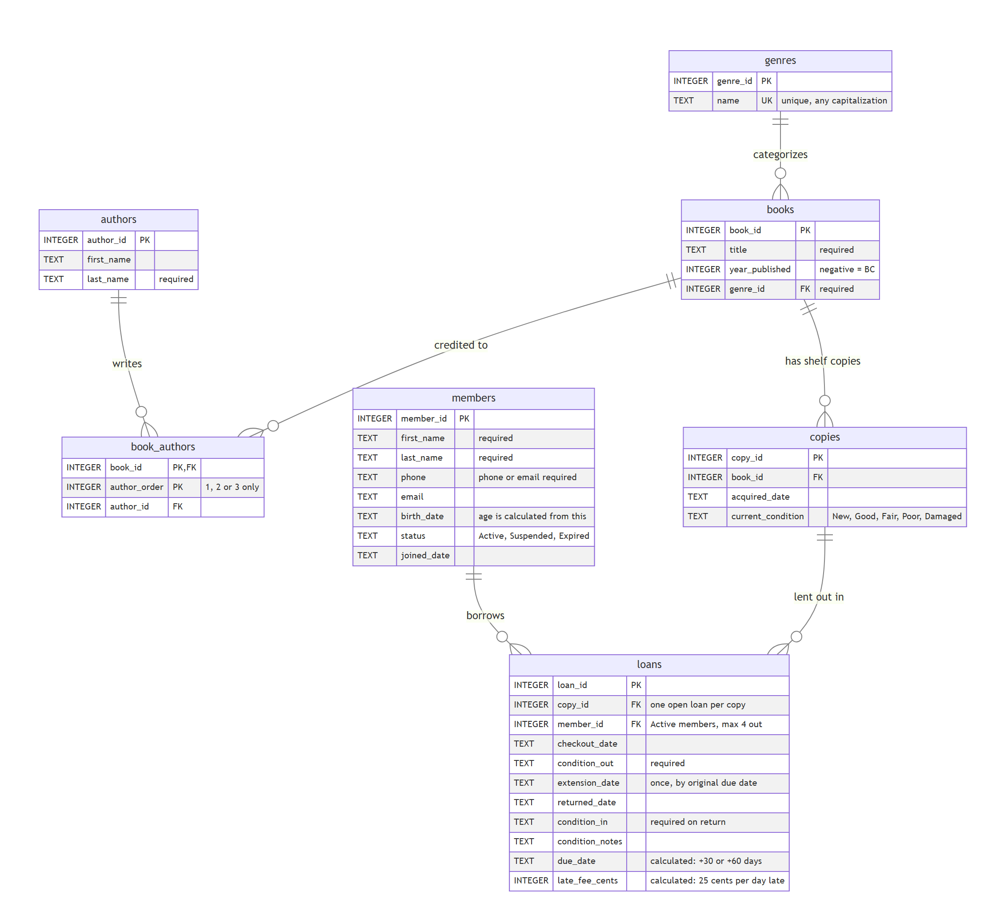
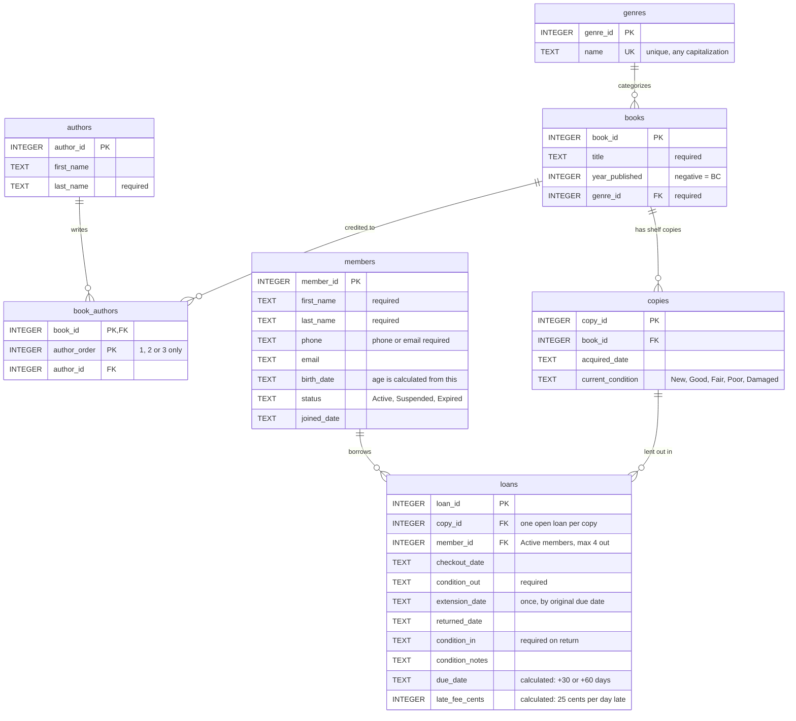

# Library Database Summary

*How to read the diagram: each box is a table. **PK** is the table's unique ID, **FK** points to a row in another table, and **UK** must be unique. On the lines, `||` means "exactly one" and `o{` means "zero or more".*

## Design Summary

I'm opening a small lending library, and this database is how I'll track what we own, who our members are, and who has what. I decided what to track and how the pieces fit together, and Claude Code built it in SQLite.

### What each table represents, and why it exists

- **books** has one row per title, such as *The Hobbit*, with its year and genre. Title details are written once, no matter how many copies I own.
- **copies** has one row per physical book on the shelf, with its current condition. I'll own more than one copy of popular titles, and people borrow a specific copy, not a title.
- **authors** has one row per person, so each author is entered once and I can find everything they wrote.
- **book_authors** links books to their authors (1st, 2nd, 3rd). A book can have several authors, and an author can write many books.
- **genres** is the list of categories, so each genre is spelled one way and the collection can be sorted by genre.
- **members** has one row per cardholder: name, contact info, birth date, and status (Active, Suspended, or Expired).
- **loans** has one row each time a copy is checked out: who, which copy, the dates out, due, and returned, any extension, the condition going out and coming back, and any late fee. It's the library's hand receipt, a record of who signed for what and when it's due back.

### Where the relationships are, and how they're tracked

**One-to-many**, meaning one row on one side matches many on the other:
- One genre has many books.
- One book has many copies.
- One member has many loans.
- One copy has many loans over time.

Each of these is tracked with a **foreign key**: the "many" side stores the ID of the "one" side. A book row holds its `genre_id`, a copy holds its `book_id`, and a loan holds a `member_id` and a `copy_id`. The database rejects any ID that doesn't point to a real row.

**Many-to-many**:
- **Books and authors.** Neither table can hold the other's ID, because a book can have three authors and an author can write many books. So `book_authors` holds one row for each book-author pair. Its `author_order` column only allows 1, 2, or 3, which caps every book at three authors.
- **Members and copies.** Over time, one member borrows many copies and one copy is borrowed by many members. The `loans` table connects them and also records the details of each checkout.

### One design decision: separating titles from copies

Because I'll own more than one copy of some books, I split the title from the physical copy, the way an inventory separates a product number from serial numbers. Title information lives once in `books`, and each copy gets its own row and condition. Loans point to a copy, not a title. That way two members can each have a copy of *The Hunger Games* at the same time, I know exactly which copy came back damaged, and the database won't let one copy be checked out twice at once.

My borrowing policy is built into the database too. Members can have at most 4 books out, and only Active members can borrow. A loan lasts 30 days, with one 30-day extension if it's requested by the due date. Late returns cost $0.25 a day, calculated automatically. Condition is recorded at checkout and at return. I store birth dates instead of ages so a member's age never goes out of date.

### One thing Claude got wrong

Claude's first version had a bug in how it checked dates. The database was supposed to reject impossible dates, but in testing it accepted a birth date of "2020-13-45", which has a month 13. SQLite treats an invalid date as blank, and the rule as written let blanks through. Claude's own test caught it before the real database was built, and Claude tightened the rule on all six date columns. Lesson: rules have to be tested, not just written.
